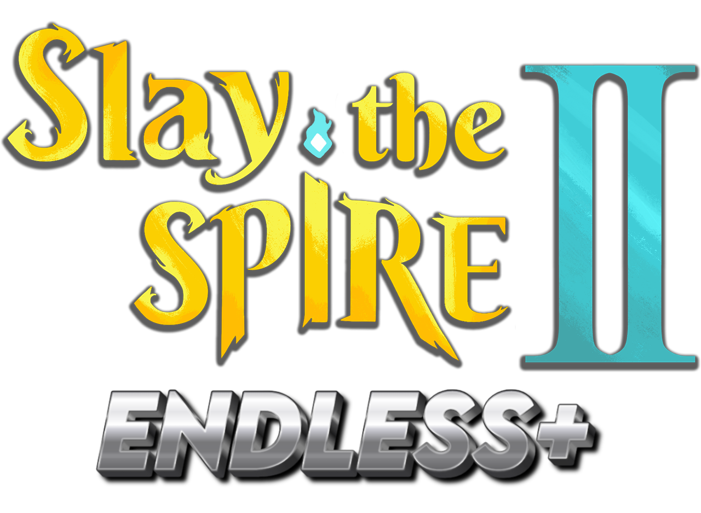

<p align="center">
  
</p>

# EndlessPlus (Slay the Spire 2 Mod)

Play **Slay the Spire 2** forever in an endless loop!

When you beat the final boss, your run does not end. You keep your character, deck, relics, and HP, and jump straight into the next chapter. To keep the game fun and challenging, monsters get stronger every loop.

---

## Features

- 🔄 **Non-Stop Endless Mode**: Run continues after beating the final boss — keep your deck, relics, and HP into the next chapter.
- 📈 **Custom Monster Scaling**: Tune enemy HP and attack damage scaling rates per Act, Chapter, or Floor.
- 📐 **Math Curves & Clamps**: Choose Exponential, Linear, or Fixed scaling, with optional min/max multiplier limits.
- 🛡️ **Flat Stat Bonuses**: Add flat HP and damage per step to keep multiplayer balance tight.
- 🤝 **Full Multiplayer Host Sync**: Host settings automatically sync to all peers — zero manual file editing needed.
- 👥 **Co-op Ready Status**: Game Over screen shows live player readiness counts (e.g. `Endless (3/4 Ready)`).
- 🎒 **Relic Row Pagination**: Relic bar is capped to 3 rows max; scroll with mouse wheel or click page toggle button.
- ✨ **New Relic Indicator**: Newly picked up relics show a golden "NEW" badge that auto-dismisses after 10 seconds.
- 🎛️ **In-Game BaseLib UI**: Configure all settings directly inside the in-game Mod Configuration menu.
- ⚡ **Instant Hot-Reload**: Changes saved to config file apply instantly mid-run without restarting.

---

## Requirements

- **Slay the Spire 2** (Steam version v0.111.1 or newer)
- **BaseLib** (*Optional* — only needed if you want the in-game settings menu. You can also configure the mod via text file without it)

---

## Installation

1. Download the latest `STS2-EndlessPlus_v*.zip` from the [Releases](https://github.com/0xb01/STS2-EndlessPlus/releases) page.
2. Extract the zip file. You will get a folder named `EndlessPlus`.
3. Move the `EndlessPlus` folder into your game's `mods` directory:
   ```
   C:\Program Files (x86)\Steam\steamapps\common\Slay the Spire 2\mods\EndlessPlus
   ```
4. *(Optional)* Install `BaseLib` in your `mods` folder if you want the in-game GUI menu.
5. Launch Slay the Spire 2 and enjoy!

---

## How to Configure

You can change settings in two ways:

### 1. In-Game Menu (Requires BaseLib)
On the Main Menu, click **Mod Configuration**, select the **Endless Plus** tab, and adjust the sliders and dropdowns.

### 2. Config File (No BaseLib Needed)
Edit `BNKZ.STS2.EndlessPlus.config` in your `mods/EndlessPlus/` folder with any text editor (Notepad, VS Code). Changes save and reload instantly!

### Settings Explained

| Setting | Default | What it does |
| :--- | :---: | :--- |
| `interval` | `act` | How often enemies get stronger: <br>• `act` = Every act transition (recommended). <br>• `chapter` = Every full chapter loop. <br>• `floor` = Every single room. |
| `skip_chapter` | `true` | **Start scale on Chapter 2**: When `true`, Chapter 1 has normal vanilla difficulty and enemy scaling begins in Chapter 2. |
| `curve` | `exponential` | How enemy stats grow: <br>• `exponential` = Stats grow faster each loop (multiplicative). <br>• `linear` = Stats grow by the same amount each loop. <br>• `fixed` = Stats stay at one fixed multiplier. |
| `hp_scale` | `1.08` | Monster Max HP multiplier per step (`1.08` = +8% HP per step). |
| `dmg_scale` | `1.05` | Monster Attack Damage multiplier per step (`1.05` = +5% damage per step). |
| `flat_hp_per_step` | `500` | Extra flat HP added to enemies per step (`500` adds +500 HP each step). |
| `flat_dmg_per_step` | `2` | Extra flat damage added to enemy attacks per step (`2` adds +2 DMG each step). |
| `min_hp_multiplier` | `1.0` | Minimum enemy HP multiplier floor (`1.0` = 1.0x). |
| `max_hp_multiplier` | `0.0` | Maximum ceiling for enemy HP multiplier (`0.0` = uncapped). |
| `min_dmg_multiplier` | `1.0` | Minimum enemy attack damage multiplier floor (`1.0` = 1.0x). |
| `max_dmg_multiplier` | `0.0` | Maximum ceiling for enemy damage multiplier (`0.0` = uncapped). |
| `ascension_per_loop` | `-1` | Ascension increase per loop: `-1` = vanilla, `0` = lock level, `1+` = increase each loop. |
| `max_ascension` | `10` | Hard ceiling for Ascension level during endless runs. |
| `override_hud` | `true` | When `true`, displays scaling stats in the top HUD banner. |

---

## Co-op / Multiplayer Details

- **Full Host Authority & Auto-Sync**: Host settings (`interval`, `curve`, `skip_chapter`, `hp_scale`, `dmg_scale`, `flat_hp_per_step`, `flat_dmg_per_step`) are automatically synchronized across all players via network metadata. Clients inherit host rules seamlessly with zero manual config matching required.
- **Live Readiness Indicator**: The Game Over screen Endless button displays live player readiness count (e.g. `Endless (3/4 Ready)`).
- **Hot-Reload Safety**: Config file reloads pause during active combat turns to prevent mid-fight desyncs.

---

## Building from Source

All required game assemblies are included in the `lib/` directory for turnkey builds:

1. Install the [.NET 9.0 SDK](https://dotnet.microsoft.com/download/dotnet/9.0).
2. Clone this repository:
   ```bash
   git clone https://github.com/0xb01/STS2-EndlessPlus.git
   cd STS2-EndlessPlus
   ```
3. Build the project:
   ```bash
   dotnet build -c Release
   ```
   Or run the one-click build script to create packaged zip archives in `/build/`:
   ```bash
   ./build.bat             # On Windows
   pwsh ./scripts/build.ps1 # On Linux / Mac / PowerShell
   ```
4. If Slay the Spire 2 is installed in the default Steam folder, the compiled DLL automatically deploys to your `mods/EndlessPlus` folder!

---

## License & Credits

- Created by **BNKZ (0xb1) & Tito's and Tita's (Mika, Rick, Fle, and others)**
- Requires **BaseLib** for in-game configuration UI
- Built with **Harmony** for runtime patching
